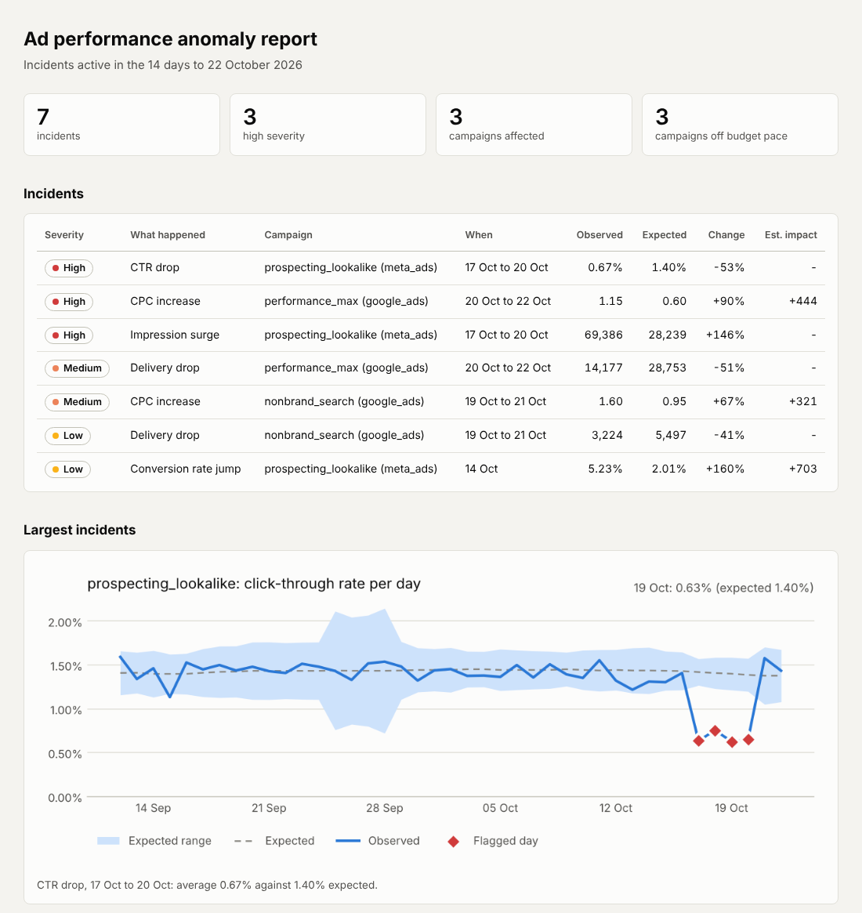
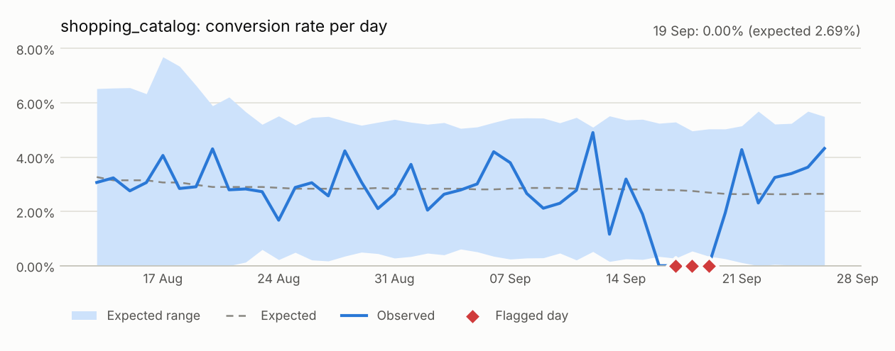

# adwatch: anomaly detection for ad performance

[](https://github.com/Guri-L/ad-performance-anomaly-detection/actions/workflows/ci.yml)

A Python package and command line tool that reads daily advertising data and reports what
went wrong: spend spikes, delivery drops, CPC and CTR shifts, broken conversion tracking,
missing data, and campaigns heading over or under their monthly budget.

It ships with synthetic data containing labelled anomalies, so the detector's accuracy is
**measured, not claimed**: on 30 generated datasets it finds 80% of injected problems with 91%
of its alerts being real ([details](#how-well-it-works)).



## Quick start

Requires Python 3.10 or newer.

```bash
git clone https://github.com/Guri-L/ad-performance-anomaly-detection.git
cd ad-performance-anomaly-detection
python -m venv .venv && source .venv/bin/activate
pip install -e ".[dev]"

adwatch detect --budgets data/sample/budgets.csv --as-of 2026-10-22
```

```text
SEVERITY WHAT                              CAMPAIGN                WHEN                  OBSERVED  EXPECTED
high     CTR drop                          prospecting_lookalike   2026-10-17 (4 days)      0.67%     1.40%
high     CPC increase                      performance_max         2026-10-20 (3 days)       1.15      0.60
high     Impression surge                  prospecting_lookalike   2026-10-17 (4 days)     69,386    28,239
medium   Delivery drop                     performance_max         2026-10-20 (3 days)     14,177    28,753
medium   CPC increase                      nonbrand_search         2026-10-19 (3 days)       1.60      0.95
low      Delivery drop                     nonbrand_search         2026-10-19 (3 days)      3,224     5,497
low      Conversion rate jump              prospecting_lookalike   2026-10-14               5.23%     2.01%

Budget pacing: 3 of 8 campaigns off pace
  under retargeting_cart        projected     3,169 of     4,380 (72%)
  over  nonbrand_search         projected     8,360 of     7,030 (119%)
  over  local_test_small        projected       970 of       820 (118%)

Report: output/report.html
```

The run writes `output/incidents.csv`, `output/pacing.csv` and a self-contained
`output/report.html` with a chart for each of the largest incidents.

| Command | What it does |
| --- | --- |
| `adwatch detect --input my.csv` | Run on your own data (see [input format](#input-format)) |
| `adwatch detect --days 0` | Report all history instead of the last 14 days |
| `adwatch detect --fail-on high` | Exit with status 1 if a high-severity incident exists, for cron or CI alerting |
| `adwatch detect --config my.yaml` | Override thresholds ([settings](config/example.yaml)) |
| `adwatch evaluate` | Measure recall and precision on freshly generated labelled data |
| `adwatch generate-data` | Regenerate the sample data |

## What it detects

| Incident | Metric watched | Method |
| --- | --- | --- |
| Spend spike or drop | Spend | Robust z-score on log values |
| Delivery drop, impression surge | Impressions | Robust z-score on log values |
| CPC increase or decrease | Spend / clicks | Robust z-score on log values |
| CTR drop or jump | Clicks out of impressions | Overdispersed binomial z-score |
| Conversion rate drop, possible tracking outage | Conversions out of clicks | Overdispersed binomial z-score, pooled over up to 3 days |
| Missing data | A day with no row inside a campaign's active dates | Calendar check |
| Over or under budget pace | Month-to-date spend plus recent run rate | Projection against monthly budget |

Consecutive flagged days are merged into one incident with a plain-language diagnosis, a
severity, and where it can be estimated, the money involved.

## How it works

Every day is compared with the same campaign's previous 28 days. Nothing looks ahead, so a
result for a given date never changes when later data arrives. That is tested.

**Level metrics (spend, impressions, CPC)** are scored on the log scale against the window's
median, with noise measured by the median absolute deviation. Both ignore outliers, so last
week's spike does not hide this week's. A weekday effect is estimated inside the window
because weekends usually differ from weekdays.

**Rate metrics (CTR, conversion rate)** are counts out of trials, and their noise depends on
volume: 2 conversions from 40 clicks says little, 200 from 4,000 says a lot. They are scored
with a binomial z-score, widened by the day-to-day variation actually seen in the window.

Two details matter in practice:

- **One day is often not enough evidence.** A campaign expecting 9 conversions a day will
  see zero by chance roughly once in 8,000 days, which is a single-day z-score of only -3.
  Three zero days in a row are conclusive. So rates are also scored on the pooled last 3 days.
- **Small campaigns are noisy by arithmetic.** A count of n varies by about 1/sqrt(n) by
  chance alone. The noise estimate for click-based metrics is never allowed below that, and
  rate checks are skipped when fewer than 5 events are expected. This cut false alerts by
  about a third in testing.

A day is flagged when its score passes the threshold **and** the change is large enough to
matter (30% for levels, 25% for rates), so statistically significant but trivial moves on
very large campaigns stay quiet.



*Conversion tracking breaks for three days. The shaded band is the expected range for that
day's click volume.*

## How well it works

`adwatch evaluate` generates fresh datasets (8 campaigns, 4 months, 24 injected anomalies
each), runs detection, and compares incidents with the labels. Results on 30 datasets that
were not used while choosing the thresholds:

| Measure | Result |
| --- | --- |
| Recall (injected anomalies found) | 79.7% (574 of 720) |
| Precision (incidents that were real) | 90.7% (99 of 1,066 were false) |
| False incidents per campaign per month | 0.10 |

| Anomaly type | Injected | Detected | Recall |
| --- | ---: | ---: | ---: |
| Spend spike | 95 | 95 | 100% |
| Delivery drop | 105 | 105 | 100% |
| CTR drop | 116 | 116 | 100% |
| Missing data | 92 | 92 | 100% |
| CPC spike | 109 | 101 | 93% |
| Tracking outage (zero conversions) | 97 | 47 | 48% |
| Conversion rate drop (down 50 to 70%) | 106 | 18 | 17% |

Spend, delivery, CTR and CPC problems are caught almost every time. Conversion problems are
not, and the reason is volume, not a bug:

| Conversions per day on the campaign | Conversion anomalies injected | Detected | Recall |
| --- | ---: | ---: | ---: |
| 15 or more | 49 | 31 | 63% |
| 5 to 15 | 109 | 34 | 31% |
| Fewer than 5 | 45 | 0 | 0% |

A campaign with one conversion a day gives no statistical basis for saying a quiet two days
is a fault. The honest options are to watch conversion rate at account level, where volume
is higher, or to accept a longer detection delay. Both are on the roadmap below.

These figures describe synthetic data whose noise I chose. Real accounts have promotions,
holidays and budget changes that will look like anomalies, so expect lower precision until
those are handled.

## Input format

One row per campaign per day, as CSV:

| Column | Type | Notes |
| --- | --- | --- |
| `date` | date | ISO format, `2026-10-22` |
| `platform` | text | For example `google_ads`, `meta_ads` |
| `campaign_id` | text | Read as text, so long numeric ids are safe |
| `campaign_name` | text | |
| `impressions`, `clicks`, `conversions` | number | Not negative; clicks cannot exceed impressions |
| `spend`, `conversion_value` | number | Account currency |

Optional budgets file for pacing: `campaign_id`, `month` (`2026-10`), `budget`.

Input is validated before anything runs. Missing columns, bad dates, negative values and
duplicate campaign-days stop the run with a message saying what to fix (exit status 2).

This is the same grain as the `rpt_paid_media_campaign_daily` table produced by my
[marketing-data-integration-pipeline](https://github.com/Guri-L/marketing-data-integration-pipeline)
project. The column names differ slightly, so a small rename is needed to connect the two.

## Use as a library

```python
from adwatch.schema import load_performance
from adwatch.detect import score, build_incidents
from adwatch.config import DetectionConfig

performance = load_performance("data/sample/ad_performance.csv")
config = DetectionConfig(level_z_threshold=5.0)
scored = score(performance, config)        # one row per campaign, metric and day
incidents = build_incidents(scored, config)  # pandas DataFrame, most severe first
```

## Project structure

```
├── src/adwatch/
│   ├── baseline.py     # the two scoring methods (numpy)
│   ├── detect.py       # scoring per campaign, incident building (pandas)
│   ├── pacing.py       # budget pacing projection
│   ├── evaluate.py     # recall and precision against labelled data
│   ├── synthetic.py    # data generator with injected anomalies
│   ├── report.py       # charts (matplotlib) and HTML report
│   ├── schema.py       # input loading and validation
│   ├── config.py       # settings with YAML overrides
│   └── cli.py          # command line interface
├── tests/              # 64 tests
├── data/sample/        # synthetic performance data, budgets and ground truth
├── config/example.yaml # every setting with its default
└── .github/workflows/  # lint, type check and tests on Python 3.10 and 3.13
```

## Development

```bash
ruff check .     # lint
mypy             # type check
pytest -q        # 64 tests
```

The tests include a regression floor on detection quality, a check that scores never use
future data, and a check that the committed sample data matches the generator.

## Limitations and roadmap

- **Known events are not modelled.** A planned promotion or budget change is flagged like any
  other change. A calendar of expected events would suppress these.
- **One cause, several incidents.** A CPC spike also reduces clicks and impressions, and each
  metric raises its own incident. Related incidents on a campaign are not yet merged.
- **Low-volume conversion tracking.** See the results above. Scoring conversion rate at
  account or platform level would catch outages that single campaigns cannot show.
- **A lasting change takes time to become normal.** After a real, permanent shift, alerts
  continue until the new level fills more than half the 28-day window.
- **New campaigns are silent for 14 days** while a baseline builds.
- **Normal approximation.** Rate scores use a normal approximation to the binomial, which is
  conservative for counts near zero. An exact test would detect outages on mid-volume
  campaigns sooner.
- **Daily data only.** No hourly detection, no direct API or warehouse connection yet.

## License

MIT
